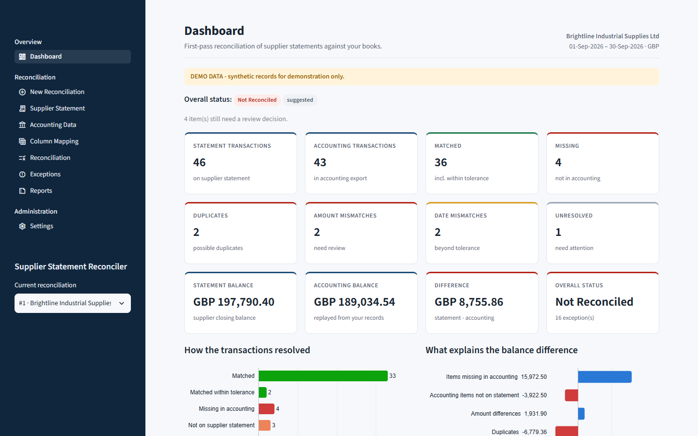
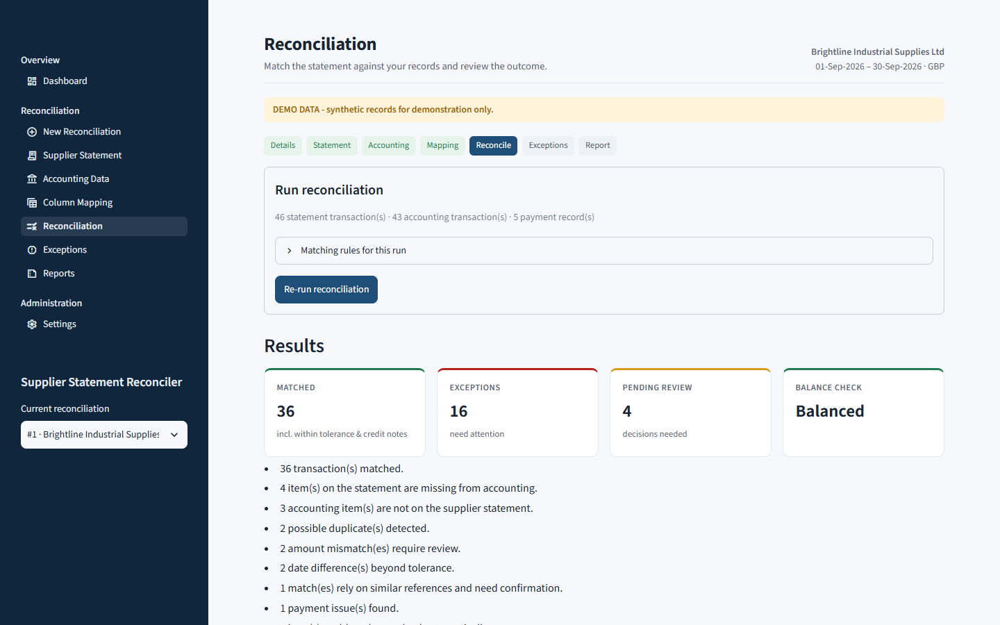
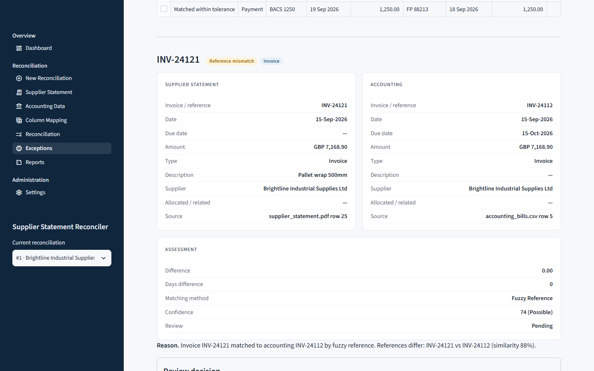
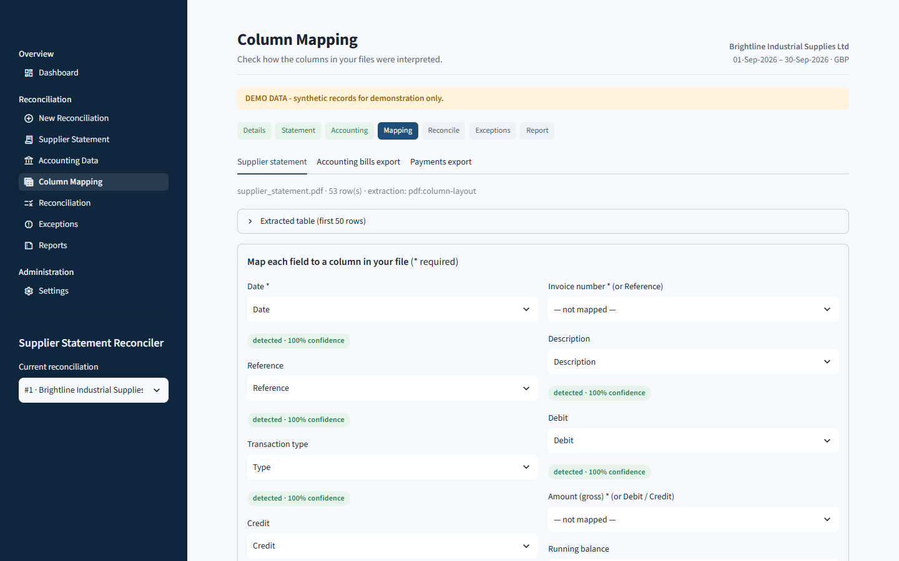

# Supplier Statement Reconciler

Automated first-pass reconciliation of **supplier statements** against **accounting
records**. It finds missing invoices, duplicate bills, amount and date differences, credit
notes, payment discrepancies, accounting-only items and statement balance differences, and
explains each one.



## The problem

Every month, small businesses and bookkeepers receive statements from suppliers and must
check them against the bills recorded in Xero, QuickBooks or Sage. Done by hand, that means
opening each statement, ticking off invoice references, comparing dates and amounts, looking
for payments and credit notes, and investigating why the balances differ. It is repetitive,
slow and error-prone, and most lines agree anyway.

## The solution

Upload the supplier statement (PDF, Excel or CSV) and the accounting export (CSV or Excel).
The application:

1. extracts the statement lines, including from multi-page PDFs with letterheads, repeated
   headers, totals, ageing summaries and wrapped descriptions;
2. detects the columns automatically and lets the user correct the mapping;
3. validates and normalises both datasets;
4. matches transactions in layers, from exact references down to cautious fuzzy and
   amount/date matching, each with a confidence score and a plain-English reason;
5. flags duplicates, missing items, amount/date/reference differences, credit notes and
   payment issues;
6. reconciles the statement balance and **explains the difference** between the
   supplier's balance and the books, category by category;
7. lets the user review uncertain matches, then exports an Excel workbook and a client-ready
   PDF report with a full audit trail.

## Who it is for

Small business owners · bookkeepers · accountants · accounts payable teams · finance
departments · accounting service providers. No programming knowledge is needed.

## Business value

The tool removes the repetitive part of supplier reconciliation and points people to the
lines that need judgement.

| | Manual | Automated first pass |
|---|---|---|
| Typical 40–50 line statement | ~2–3 hours | ~10–20 minutes, mostly reviewing exceptions |

*Illustrative estimates, not guaranteed results. Actual time depends on document quality
and the number of exceptions.*

## Features

- **Statement import**: PDF (ruled tables, column-aligned text across pages, PyMuPDF
  fallback), XLSX (best sheet auto-selected) and CSV (encoding and delimiter detection)
- **Accounting import**: CSV/XLSX bills, credit notes and payments; Xero, QuickBooks
  (including grouped reports) and Sage layouts recognised; other suppliers' rows excluded
- **Column mapping** with detection confidence, date-order and number-format overrides
- **Validation summary**: records read, valid, warnings and errors; erroneous rows must be
  fixed or explicitly acknowledged
- **Layered matching** (exact → reference core + amount → reference core + date → fuzzy →
  amount/date proximity) with configurable tolerances and confidence bands
- **Duplicate detection** with graded confidence (never "every similar record")
- **Mismatch detection**: amount (exact / within tolerance / mismatch), date and reference
- **Credit notes and payments**: payment-run handling, explicit allocation only, outstanding
  amounts, overpayments, unverified payments
- **Balance reconciliation**: statement arithmetic, running-balance checks, and a
  statement-vs-accounting difference fully broken down by cause
- **Exception management**: review queue, categories, search and filters, side-by-side
  investigation, accept / reject / mark unresolved, with notes
- **Reports**: Excel workbook (Summary, Matched, Missing, Duplicates, Amount/Date/Reference
  Mismatches, Credit Notes, Payment Issues, Accounting Only, Unresolved, Balance Check, Audit
  Trail), CSV export and a PDF client report
- **Audit trail**: files (with SHA-256), mappings, settings, runs and review decisions
- **Demo mode**: one click creates a realistic synthetic reconciliation

## Screenshots

| Reconciliation results | Side-by-side investigation |
|---|---|
|  |  |

| Column mapping | |
|---|---|
|  | |

*All screenshots show synthetic DEMO data.*

## Architecture

```text
Streamlit UI (app.py, pages/, ui/)        presentation only
        │
Services (src/services)                   import · normalisation · reconciliation · review · export · report
        │
Parsers & providers │ Reconciliation engine │ Database (SQLAlchemy + SQLite)
(src/parsers,       │ (src/reconciliation)  │ (src/database)
 src/accounting)    │                       │
        └──── Canonical models (Pydantic) · Decimal money utilities ────┘
```

All sources become one canonical transaction model, so the engine does not care whether
data came from a PDF, an Excel export or, later, an accounting API. Money is always
`Decimal`. See [docs/ARCHITECTURE.md](docs/ARCHITECTURE.md) and
[docs/RECONCILIATION_LOGIC.md](docs/RECONCILIATION_LOGIC.md).

## Technology stack

Python 3.12+ · Streamlit · SQLAlchemy · SQLite · Pydantic · pdfplumber · PyMuPDF ·
openpyxl · RapidFuzz · pandas · Plotly · ReportLab · pytest · Ruff · mypy. All are free and
open source; see [docs/FREE_RESOURCES.md](docs/FREE_RESOURCES.md), including a licence
note on PyMuPDF (AGPL).

## Installation

Requires Python 3.12 or newer.

### Windows

```bat
python -m venv .venv
.venv\Scripts\activate
pip install -r requirements.txt
```

### macOS / Linux

```bash
python3 -m venv .venv
source .venv/bin/activate
pip install -r requirements.txt
```

For development (tests, linting, type checks): `pip install -r requirements-dev.txt`.

## Configuration

No configuration is required. Optional settings go in a `.env` file. Copy `.env.example`
to `.env`; it is git-ignored.

| Variable | Default | Purpose |
|---|---|---|
| `SSR_DATA_DIR` | `data` | Where the database, uploads and logs are stored |
| `SSR_DATABASE_URL` | `sqlite:///<data>/reconciler.db` | Alternative SQLAlchemy URL |
| `SSR_MAX_UPLOAD_MB` | `25` | Upload size limit |
| `SSR_LOG_LEVEL` | `INFO` | `DEBUG`, `INFO`, `WARNING`, `ERROR` |
| `SSR_DEFAULT_AMOUNT_TOLERANCE` | `0.01` | Default amount tolerance |
| `SSR_DEFAULT_DATE_TOLERANCE_DAYS` | `3` | Default date tolerance |
| `SSR_FUZZY_MATCH_THRESHOLD` | `80` | Default fuzzy reference threshold |
| `XERO_CLIENT_ID` / `XERO_CLIENT_SECRET` / `XERO_REDIRECT_URI` | – | Reserved for the future Xero integration |
| `QUICKBOOKS_CLIENT_ID` / `QUICKBOOKS_CLIENT_SECRET` / `QUICKBOOKS_REDIRECT_URI` | – | Reserved for the future QuickBooks integration |

Matching rules can also be changed in the app (**Settings**); each run records the rules
it used.

## Running the application

```bash
streamlit run app.py
```

Then open <http://localhost:8501>. To try it immediately, click **Load demo reconciliation** on
the dashboard and then **Run reconciliation**.

## Generating demo data

```bash
python scripts/generate_demo_data.py                       # 40 invoices into sample_data/
python scripts/generate_demo_data.py --count 200 --seed 7 --output-dir demo_out
```

This produces a two-page PDF statement plus CSV/XLSX versions, a Xero-style bills export
(with another supplier's rows), a payments export and a scenario manifest. Everything is
fictional and labelled DEMO DATA. See [sample_data/README.md](sample_data/README.md) and the
presentation script in [docs/DEMO_GUIDE.md](docs/DEMO_GUIDE.md).

## Testing

```bash
pytest                       # full suite
pytest --cov                 # with coverage
ruff check . && ruff format --check .
mypy                         # static types for src/
```

The suite covers money and date parsing, normalisation, every matching level, confidence,
tolerances, duplicates, mismatches, credit notes, payments, balances, CSV/Excel/PDF parsing
(including multi-page and malformed files), the database, exports, the PDF report, security
behaviour, UI page rendering, a 5,000-record performance check and an end-to-end
reconciliation of the demo dataset. CI runs on every push (GitHub Actions).

## Real-world documents

The parsers handle many real-world layouts and have been tested against synthetic files that
reproduce them. **They have not yet been validated against genuine client documents.**
[docs/REAL_WORLD_DATA_REQUIREMENTS.md](docs/REAL_WORLD_DATA_REQUIREMENTS.md) lists what is
needed (anonymised statements and exports) and how to redact them.

To check a real document locally without storing it anywhere:

```bash
python scripts/analyze_document.py client_data/statement.pdf
python scripts/analyze_document.py client_data/bills.csv --role accounting --supplier "Supplier A"
```

## Data sources

Only synthetic data is committed. Official demo environments (Xero Demo Company, QuickBooks
Online sandbox) can produce realistic exports for local testing. See
[docs/DATA_SOURCES.md](docs/DATA_SOURCES.md).

## Privacy

- Runs locally; uploads, database and logs stay in the local `data/` folder (git-ignored).
- Real client documents must never be committed. Use `client_data/` or `private/`
  (git-ignored) for local testing.
- Uploads are validated (type, size, signature, macros, zip bombs) and stored with sanitised
  names inside a confined folder.
- Logs contain counts and identifiers, never invoice numbers, amounts or descriptions.
- Text from documents is escaped in the UI, and formula injection is neutralised in exports.

Details: [docs/SECURITY.md](docs/SECURITY.md). Client onboarding:
[docs/CLIENT_ONBOARDING_CHECKLIST.md](docs/CLIENT_ONBOARDING_CHECKLIST.md).

## Roadmap

### Xero integration

OAuth 2.0 connection; import bills (`ACCPAY`), supplier credit notes
and payments for a contact and period directly via the Accounting API. The provider
interface (`src/accounting/xero_provider.py`) is in place and reports "Not configured" until
then. No API calls are faked.

### QuickBooks Online integration

OAuth 2.0; import `Bill`, `VendorCredit` and
`BillPayment` records for a vendor. The interface is in place
(`src/accounting/quickbooks_provider.py`).

### Later phases

- Multiple suppliers per run and supplier-specific parsing profiles
- Cloud deployment, multi-user accounts and role-based access
- OCR / document-intelligence extraction for scanned statements (only where it solves a real
  extraction problem)
- Human-in-the-loop learning from review decisions
- Emailed reports and scheduled reconciliations
- Extended audit trail and analytics across suppliers and periods

## Project structure

```text
app.py                  Streamlit entry point
pages/                  UI pages
ui/                     theme, components, charts, session state
src/models/             canonical data models
src/parsers/            statement parsers, column detection, row transformer
src/accounting/         accounting providers (CSV, Excel, Xero/QuickBooks placeholders)
src/reconciliation/     matching engine and its components
src/database/           SQLAlchemy models and repository
src/services/           import, normalisation, reconciliation, review, export, report, demo data
src/utils/              money, dates, normalisation, upload validation
scripts/                demo data generator, document diagnostic tool
tests/                  test suite
sample_data/            synthetic DEMO files
docs/                   documentation
```
